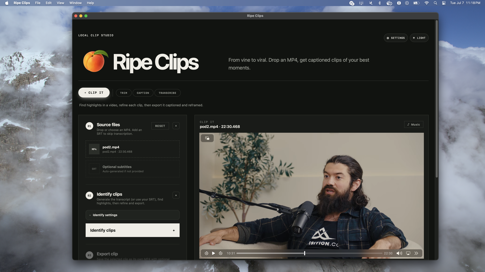
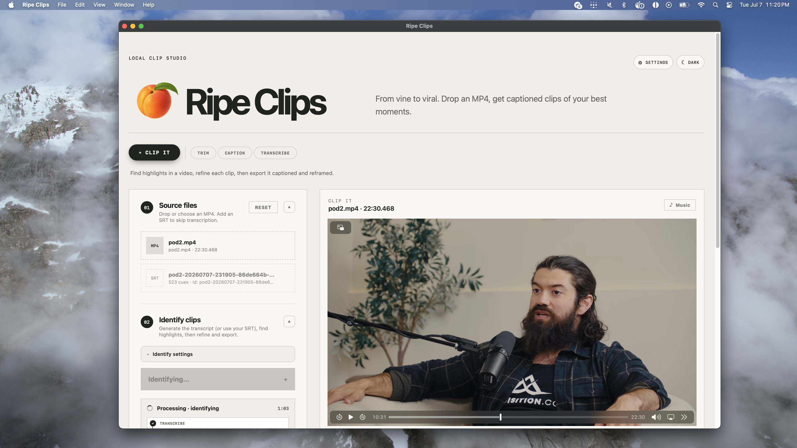
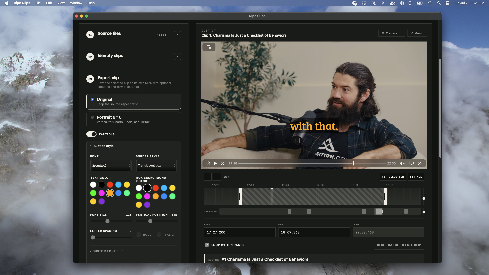
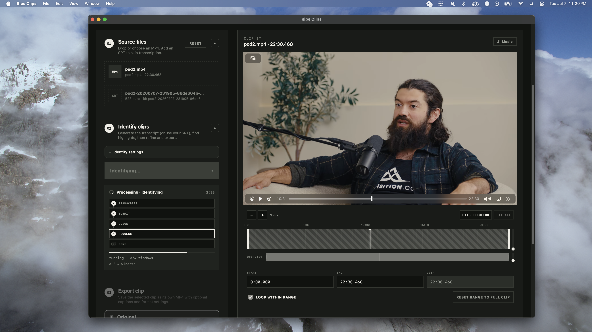
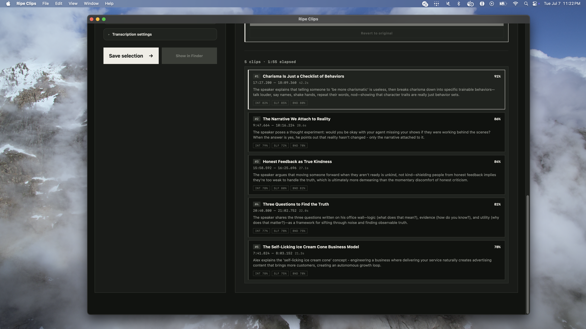
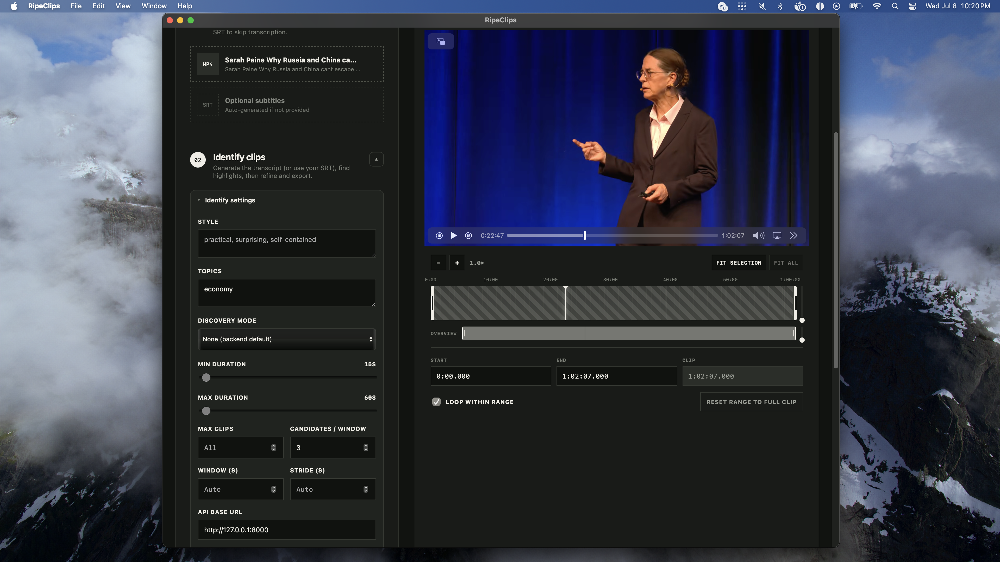
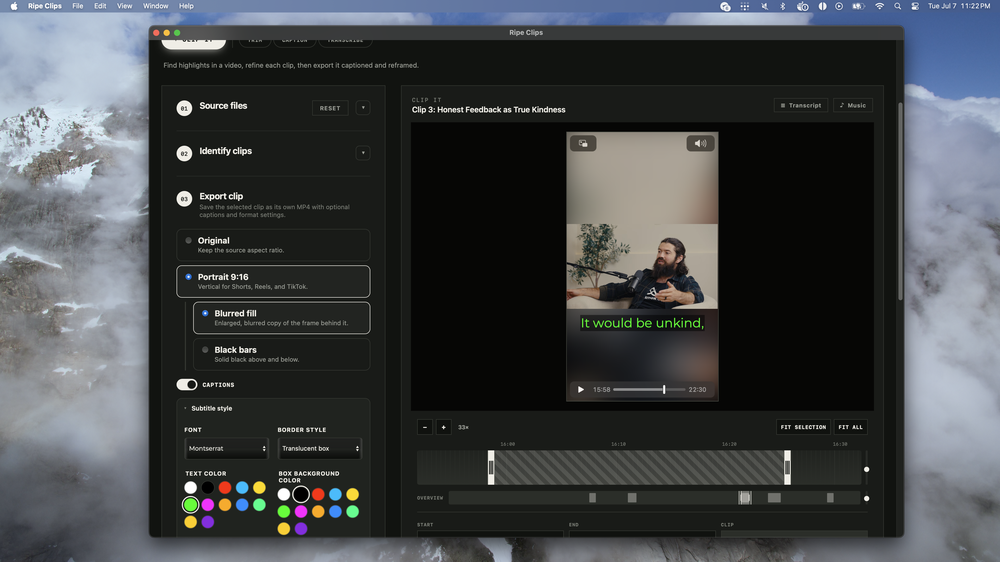
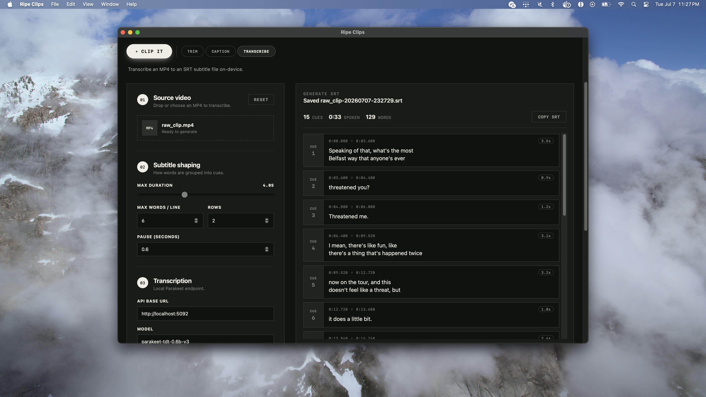

<div align="center">

<h1>
  RipeClips
</h1>

Find the best moments, trim them, reframe to 9:16, generate captions, and burn
them in. Connect RipeClips to transcription and LLM services you configure.

**Requirements:** macOS 11+ on Apple Silicon, Docker for the bundled
transcription and highlight services, and an OpenAI-compatible LLM endpoint.




</div>

---

## Contents

- [How it works](#how-it-works)
  - [Identify highlights](#identify-highlights)
  - [Trim, caption & transcribe](#trim-caption--transcribe)
- [Quick start](#quick-start)
- [LLM privacy](#llm-privacy)
- [Supported platforms](#supported-platforms)
- [Release model](#release-model)
- [Fast and lightweight](#fast-and-lightweight)
- [Kudos](#kudos)
- [License](#license)

---

## How it works

### Identify highlights

Open the **Clip it** tab and drop in an MP4.

RipeClips keeps clip selection, trimming, captioning, and export in a native
desktop workflow. You choose the transcription and LLM endpoints it uses.

<div align="center">
  
</div>

<div align="center">
  
  
</div>


Steer the LLM in **_Identify settings_**:

<div align="center">
  
</div>


---

**Trim, caption & transcribe**

- Trim & export in portrait 9:16 with a live preview, styled captions, and
  optional background music on any clip.

<div align="center">
  
</div>
<div align="center">
  <p>Full styling with a live preview: 18 bundled fonts, 12 color presets, 15
  caption style variations, bold/italic toggles, custom font files, and
  adjustable font size, letter spacing, and vertical position.</p>
</div>

- Generate word-timed SRTs.

<div align="center">
  
</div>

---

## Quick start

Start Ollama with the `gemma4` model, then start the transcription and
highlight services. The default Docker configuration connects to Ollama on the
host at `http://host.docker.internal:11434/v1`:

```bash
ollama pull gemma4
docker compose up --build
```

> Any OpenAI-compatible `/chat/completions` endpoint works. See
> [highlightr/README.md](highlightr/README.md) for configuration examples.

Verify both services are live:

```bash
curl http://localhost:5092/health   # parakeet
curl http://localhost:8000/health   # highlightr
```

> See [`highlightr/README.md`](highlightr/README.md) for every tuning option and
[`parakeet/README.md`](parakeet/README.md) for GPU deployment and model
variants.

Launch the native app:

```bash
cd app
./scripts/check-deps.sh
mise exec -- npm install
mise exec -- npm run setup:ffmpeg
mise exec -- npm run tauri:dev
```

> Full prerequisite walkthrough (Rust, Xcode CLT, FFmpeg with `libass`/`libx264`)
is in [`app/README.md`](app/README.md#installing-the-prerequisites).

## LLM privacy

Highlight identification sends transcript text, timestamps, optional speaker
names, selection preferences, and candidate excerpts to the configured LLM
endpoint. With the default configuration this is the Ollama server running on
your host. If you configure a hosted provider, that provider receives this
content and handles it under its own data and retention policies.

RipeClips does not send video or audio files to the LLM. Audio is sent only to
the configured transcription service. See [PROMPTS.md](PROMPTS.md) for every
LLM prompt and a precise description of the data included in each request.

## Supported platforms

RipeClips is currently supported and tested on **macOS 11 (Big Sur) or later
running on Apple Silicon (arm64)**. The desktop app and bundled FFmpeg setup
are not yet supported on Intel Macs, Windows, or Linux. The Docker services can
run separately on other platforms, but that configuration is not currently
supported as a complete RipeClips installation.

## Release model

`v0.1.0` is a source-only release. It does not include a prebuilt application,
DMG, or FFmpeg binary. Clone the repository and follow the build instructions
to create a local development build using an FFmpeg installation you supply.

## Fast and lightweight

```
   ┌──────────────────────────────┐
   │      RipeClips app           │
   │  Tauri desktop app (app/)    │
   │  bundled FFmpeg sidecar      │
   └───────┬──────────────┬───────┘
           │              │
 transcribe│              │identify highlights
           ▼              ▼
    ┌────────────────┐   ┌──────────────────┐
    │  parakeet-cpu  │   │  highlightr-api  │
    │  ASR :5092     │   │  highlights :8000│──►  your LLM
    │  (parakeet/)   │   │  (highlightr/)   │   (OpenAI-compatible)
    └────────────────┘   └──────────────────┘
```

RipeClips keeps the UI lean with [Tauri](https://tauri.app): a native Rust shell
without an Electron-sized runtime.

Transcription is handled by [Parakeet TDT 0.6B v3](https://huggingface.co/nvidia/parakeet-tdt-0.6b-v3)
through ONNX Runtime, so local SRT generation is fast even before you reach for
GPU acceleration.

Rendering stays native in the desktop app. Cuts, 9:16 reframes, caption burn-in,
and background music mixes run through the bundled [FFmpeg](https://ffmpeg.org)
sidecar with `libass` and `libx264`.

---

## Who it's for

- 🎙️ **Podcasters & creators** turning long episodes into vertical clips for
  TikTok, Reels, and Shorts.
- 🎚️ **Podcast studios & managers** producing and organizing clips across
  multiple shows, hosts, or clients.
- 🔬 **Researchers** extracting focused moments from interviews, field
  recordings, presentations, and qualitative research.
- 🎓 **Professors & educators** repackaging lectures, seminars, and course
  recordings into concise, shareable videos.
- 🎮 **Streamers** finding highlights in long broadcasts and exporting them for
  short-form platforms.
- 📰 **Journalists & documentarians** working with long interviews and footage.


---

## Kudos

Huge thanks to the projects and teams behind:

**Desktop app**
- [Tauri](https://tauri.app), [Vite](https://vitejs.dev)  — the Rust + webview framework and dev server.
- [FFmpeg](https://ffmpeg.org), [libass](https://github.com/libass/libass), [x264](https://www.videolan.org/developers/x264.html) — the media engine behind every cut, reframe, and
  caption burn-in.

**Transcription & Highlights**
- [NVIDIA Parakeet TDT 0.6B v3](https://huggingface.co/nvidia/parakeet-tdt-0.6b-v3) — the multilingual speech-to-text model.
- The [`parakeet/`](parakeet/) service is a vendored fork of [groxaxo/parakeet-tdt-0.6b-v3-fastapi-openai](https://github.com/groxaxo/parakeet-tdt-0.6b-v3-fastapi-openai) (MIT), which itself builds on [Shadowfita/parakeet-tdt-0.6b-v2-fastapi](https://github.com/Shadowfita/parakeet-tdt-0.6b-v2-fastapi). See [`parakeet/README.md`](parakeet/README.md#-acknowledgments) for full attribution and the upstream license.
- [ONNX Runtime](https://onnxruntime.ai),
  [onnx-asr](https://github.com/istupakov/onnx-asr) — fast CPU/GPU inference.
- [Silero VAD](https://github.com/snakers4/silero-vad) — voice-activity
  detection for auto-chunking long audio.
- [FastAPI](https://fastapi.tiangolo.com), 
  [Uvicorn](https://www.uvicorn.org), [Pydantic](https://docs.pydantic.dev) — the API server.
- Any OpenAI-compatible LLM — self-hosted via
  [Ollama](https://ollama.com), [LM Studio](https://lmstudio.ai), or
  [vLLM](https://github.com/vllm-project/vllm), or hosted through providers like
  [OpenAI](https://openai.com) and [OpenRouter](https://openrouter.ai).

---

## License

MIT. The source release does not distribute an FFmpeg binary. Locally built or
redistributed application bundles must comply with the terms of the FFmpeg
build they include; see
[`app/README.md`](app/README.md#distribution-notes) for distribution notes and
[THIRD_PARTY_NOTICES.md](THIRD_PARTY_NOTICES.md) for included third-party
components and attribution.
