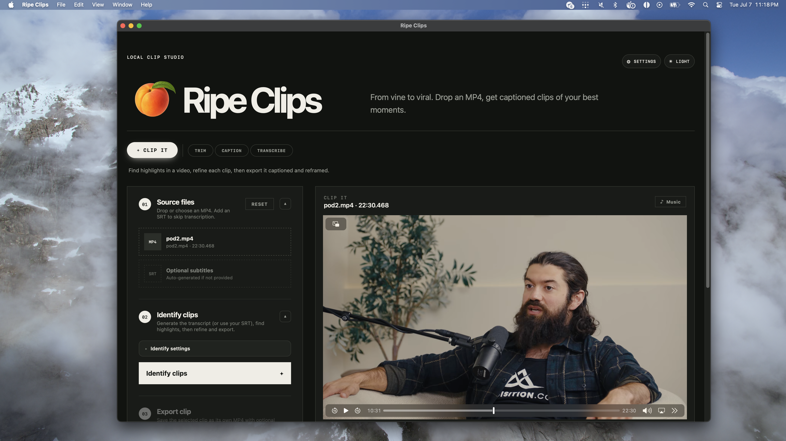
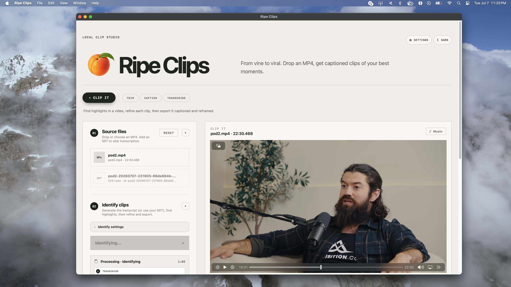
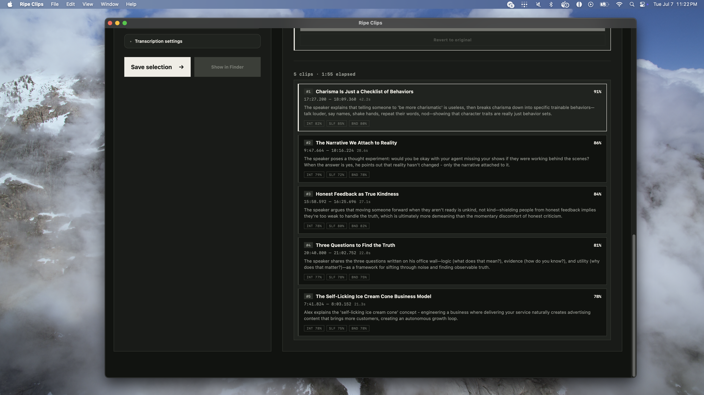
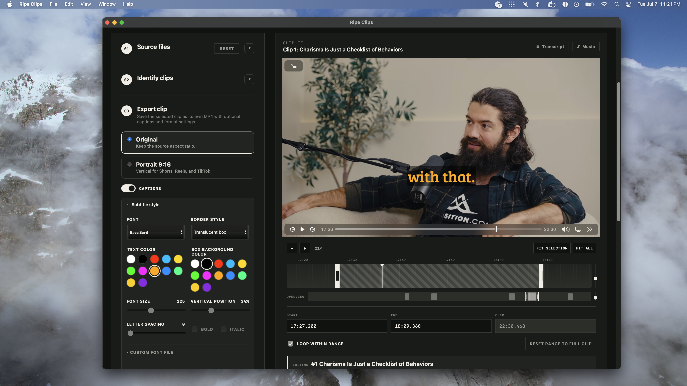
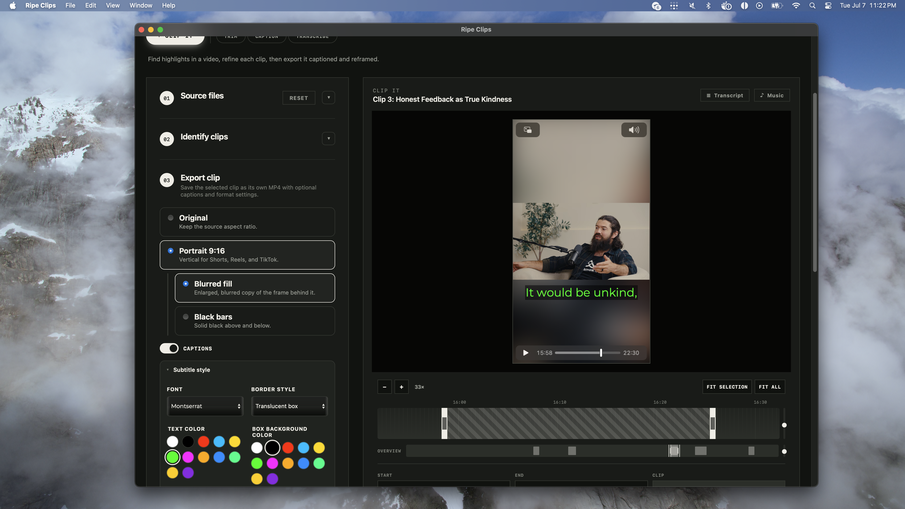
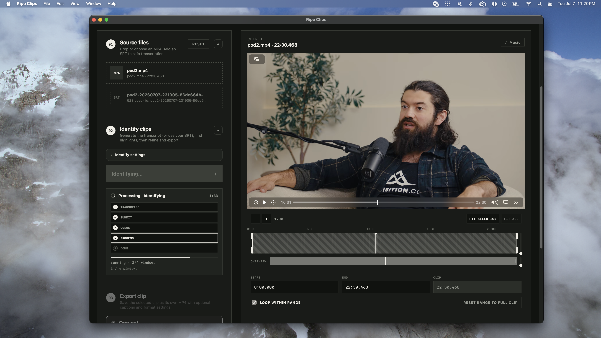
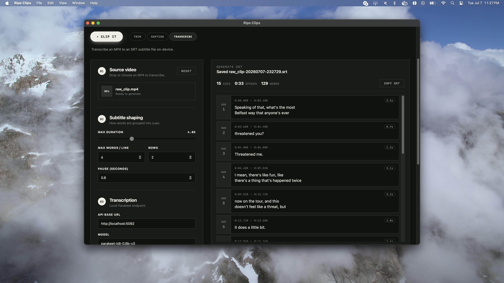

<div align="center">


# RipeClips

Find the best moments, trim them, reframe to 9:16, generate captions, and burn
them in.

[](#license)
[-black.svg)](#requirements)
[](https://tauri.app)
[](#contributing)

<br />




<sub><i>RipeClips ships with a dark and light theme.</i></sub>

</div>

---

## Why RipeClips

RipeClips is a native desktop app for finding and exporting video clips. It
drives a bundled FFmpeg build and connects to transcription and highlight
services you configure.

- **Native and fast.** Rendering runs through a native FFmpeg sidecar (with
  `libass` and `libx264`), not a WebAssembly build.
- **Open source.** Released under the MIT license.

---

## Features

RipeClips leads with **Clip it**, the full AI-assisted pipeline, and backs it
with three focused tools — **Trim**, **Caption**, and **Transcribe** — for when
you want to run a single step by hand. Everything shares a live preview, an
optional background-music bed, and a dark/light theme.

### 🎬 Clip it — from a raw video to a clip
The full pipeline. Drop an MP4 (an SRT is optional) and RipeClips will:

1. **Transcribe** the audio when no subtitles are supplied.
2. **Identify highlights** through a self-hosted Highlights API backed by the
   LLM of your choice (any OpenAI-compatible endpoint) — steer it with a
   free-form style prompt, focus topics, discovery-mode presets
   (`best_only`, `topic_focused`, `topic_only`, `coverage`, `research_sweep`),
   clip length bounds, and per-window candidate counts.
3. **Refine** each detected clip on a zoomable, scrubbable timeline with
   draggable in/out handles, an overview minimap, and precise timestamp inputs.
   Overwrite a clip's bounds or revert to the original. The list of detected
   clips lays out in full — pick any one to load it into the editor.
4. **Reframe & caption** the export: switch to **portrait 9:16** with a live
   preview and optionally burn in styled captions (transcription settings only
   apply on render, so the preview stays stable).
5. **Export** the selected clip to a single MP4.

<div align="center">
  
  <br />
  <sub><i>Clip it — highlights identified by your chosen LLM, each ready to refine and export.</i></sub>
  <br /><br />
  
  <br />
  <sub><i>Refine a detected clip's bounds on a zoomable, scrubbable timeline with an overview minimap.</i></sub>
</div>

### ✂️ Trim — precise cuts and vertical reframing
A zoomable timeline trimmer: loop within a range while you dial it in, scrub
with a hover tooltip, zoom to fit selection or the whole clip, and export a
frame-accurate re-encode (constant 30 fps, QuickTime-compatible). Optionally
reframe the export to a **1080×1920 portrait 9:16** for short-form platforms —
the whole frame centered on a vertical canvas (pillarbox) over either a
**blurred fill** (an enlarged, frosted copy of the frame) or solid **black
bars** — with the same live 9:16 preview as Clip it.

<div align="center">
  
  <br />
  <sub><i>Trim — loop a range on a zoomable timeline and reframe to portrait 9:16.</i></sub>
</div>

### 💬 Caption — transcribe and burn in one pass
The end-to-end captioning flow. Drop an MP4 and hit **Run**: if no SRT is
supplied, the audio is transcribed first, then the styled captions are
burned into a new MP4 — one step, video in, captioned video out.

- **Attach an SRT** to skip transcription, or leave it blank and let Run
  transcribe for you. Attaching an SRT greys out the transcription settings,
  since there's nothing to transcribe.
- **Tune transcription** (words per line, rows, max cue duration, pause
  splitting, endpoint, model) when generating from audio.
- **Full styling** with a live preview:
  - **18 bundled fonts** (Anton, Barlow Condensed, Montserrat, Permanent
    Marker, and more), or load your own `.ttf`/`.otf`/`.ttc`.
  - **12 color presets** for fill, outline, and box background, plus bold/italic
    toggles.
  - **15 style variations** — outlines, drop shadows, and translucent/solid
    caption boxes.
  - Adjustable font size, letter spacing, and vertical position.
- **Save generated SRT** — when the transcript was generated (not supplied), an
  escape-hatch button lets you keep the intermediate SRT.

<div align="center">
  
  <br />
  <sub><i>Caption — style captions with a live preview, then transcribe and burn in one pass.</i></sub>
</div>

### ✍️ Transcribe — word-timed SRTs
Extract a video's audio, transcribe it through a self-hosted
Parakeet-compatible endpoint, and convert the word-level timings into readable
SRT cues. Tune words per line, rows, max cue duration, and pause splitting.
Intermediate audio is cleaned up automatically; the finished cues render as a
card view you can copy or reveal in Finder.

<div align="center">
  
  <br />
  <sub><i>Transcribe — word-timed SRT cues rendered as copyable cards.</i></sub>
</div>

### 🎵 Background music
Point RipeClips at local folders of audio (MP3, M4A, AAC, WAV, FLAC, OGG,
OPUS, AIFF, WMA). Preview a track looping under the clip, set the bed volume
(default 10%, capped at 50% so it never buries speech), and choose per-export
whether to mix it in. Folders are remembered between launches; audio is read
straight from disk.

---

## How it works (in three steps)

```
  ┌────────────┐      ┌─────────────────────┐      ┌────────────────────┐
  │ 1. Add a   │  →   │ 2. Find & refine    │  →   │ 3. Export clips    │
  │    video   │      │    the moments      │      │    captioned/9:16  │
  └────────────┘      └─────────────────────┘      └────────────────────┘
   Drop an MP4         Transcription +               Burn captions, reframe
   (SRT optional)      highlight detection,          to vertical, add music,
                       timeline trimming             save the clip
```

Video in, clips out.

## Requirements

You need **macOS 11 (Big Sur) or later on Apple Silicon (arm64)** plus four
tools: Xcode Command Line Tools, Rust/Cargo 1.85 or newer, mise-managed
Node.js 24, and a local FFmpeg (with `libass` and `libx264`).

The AI-assisted flows require two services:

- A **Parakeet-compatible transcription endpoint** (default
  `http://localhost:5092`) for generating SRTs — used by **Caption**,
  **Transcribe**, and **Clip it** (when no SRT is supplied).
- A **Highlights API** (default `http://127.0.0.1:8000`) for highlight
  detection — used by **Clip it**.

This repository includes both services: see [Parakeet](../parakeet/README.md)
and [highlightr](../highlightr/README.md) for setup and startup instructions.

The **Trim** tool works fully offline with no external services. **Caption** is
offline too when you supply your own SRT.

---

## Quick start

Install the pinned Node version first, then run the dependency checker. The
checker is read-only and tells you exactly what is installed and what to
install:

```bash
mise trust
mise install
./scripts/check-deps.sh
```

Once everything reports `ok`, set up and launch:

```bash
mise exec -- npm install
mise exec -- npm run setup:ffmpeg
mise exec -- npm run tauri:dev
```

See [Installing the prerequisites](#installing-the-prerequisites) below for how
to install anything the checker reports as `missing`.

---

## Installing the prerequisites

Every command is run from a terminal, from this project directory.

### 1. Xcode Command Line Tools
Provides the C compiler and linker that Rust needs.

```bash
xcode-select --install
```

If it is already installed, this prints a message and exits — that is fine.

### 2. Rust toolchain (`cargo`, `rustc`)
The Tauri backend is written in Rust. Use Cargo 1.85 or newer so Cargo can
parse dependencies that use Rust 2024-edition manifests.

```bash
curl --proto '=https' --tlsv1.2 -sSf https://sh.rustup.rs | sh
```

Restart the terminal afterwards (or run `source "$HOME/.cargo/env"`), then
confirm with:

```bash
cargo --version # should print 1.85.0 or newer
```

If Cargo is already installed but older than 1.85:

```bash
rustup update stable
```

### 3. Node.js 24 (via mise)
This project pins Node 24 in `mise.toml`. Using [mise](https://mise.jdx.dev)
guarantees the right version even if another Node is installed.

Install mise once if you do not have it:

```bash
curl https://mise.run | sh
```

Then install the pinned Node version from this project directory:

```bash
mise trust
mise install
mise exec -- node --version  # should print v24.x
```

> Why `mise exec --`? On some setups another Node sits earlier on `PATH` in
> non-interactive shells, and Vite requires Node 20+. Prefixing commands with
> `mise exec --` forces the pinned Node 24. If your plain `node --version`
> already prints v24, you can drop the prefix.

### 4. A local FFmpeg (for the bundled sidecar)
A local application build bundles a native FFmpeg binary, but no FFmpeg binary
is included in the source release or committed to git. The setup step copies
one from your machine, so you need a local FFmpeg that includes `libass` and
`libx264`:

Homebrew core's current `ffmpeg` formula does not include the `subtitles`
filter, even when `libass` is installed separately. Use the
[`homebrew-ffmpeg` tap](https://github.com/homebrew-ffmpeg/homebrew-ffmpeg),
whose default FFmpeg build includes both `libass` and `x264`:

```bash
brew uninstall ffmpeg
brew trust homebrew-ffmpeg/ffmpeg
brew tap homebrew-ffmpeg/ffmpeg
brew install homebrew-ffmpeg/ffmpeg/ffmpeg
```

`libass` provides FFmpeg's `subtitles` filter and `x264` provides its
`libx264` encoder. The setup command below verifies that the FFmpeg binary
actually exposes both features.

Or set `FFMPEG_SRC=/path/to/ffmpeg` when running the setup step.

---

## Install and set up

Run these from the project directory, in order:

```bash
# 1. Install JS dependencies (Tauri CLI, Vite, plugins)
mise exec -- npm install

# 2. Vendor the native FFmpeg sidecar into src-tauri/binaries/
mise exec -- npm run setup:ffmpeg
```

Step 2 copies your local FFmpeg to
`src-tauri/binaries/ffmpeg-aarch64-apple-darwin` and fails unless it exposes
both the `subtitles` filter (provided by `libass`) and the `libx264` encoder.
To point at a specific build:

```bash
FFMPEG_SRC=/path/to/ffmpeg mise exec -- npm run setup:ffmpeg
```

The FFmpeg sidecar is gitignored and bundled into the app at build time. You
only need to run the setup step once per clone.

---

## Contributing

Contributions are welcome — new caption styles, additional transcription
backends, reframe modes, or platform support. Open an issue to discuss larger
changes first, then send a PR.

---

## Distribution notes

- `v0.1.0` is source-only. No prebuilt application, DMG, or FFmpeg binary is
  distributed by the project.
- Public distribution requires Apple Developer signing and notarization. Current
  builds are unsigned and intended for local use; Gatekeeper will warn until you
  sign and notarize.
- The bundled FFmpeg build includes `libx264` and is therefore GPL. Record the
  FFmpeg build source and comply with its LGPL/GPL obligations when
  distributing. Replace the vendored binary with your own audited build for any
  public release.

---

## License

RipeClips is released under the **MIT License**. The source release does not
include FFmpeg. Any FFmpeg binary included in a locally built or redistributed
application remains under its own LGPL/GPL terms — see
[Distribution notes](#distribution-notes).
